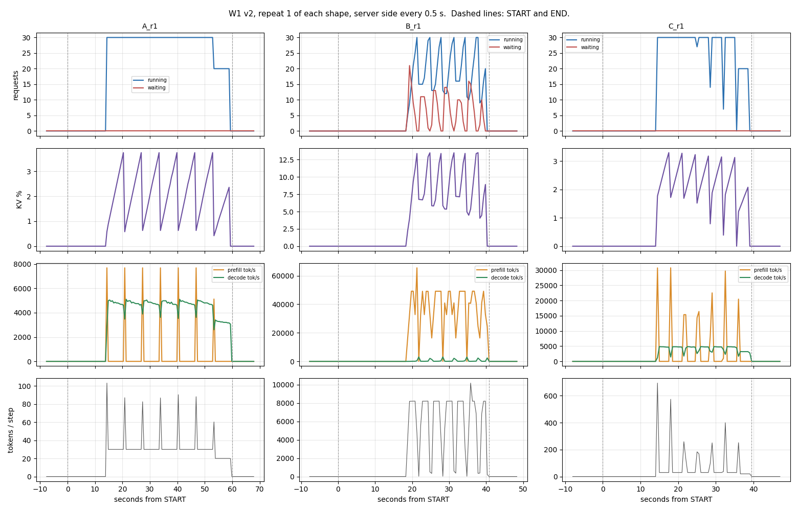

# W1 v2 Baseline Record

The "before" every later lab measures against, from 30 Sep onwards. It replaces the
v1 hand run of 21 Sep as the baseline; v1 stays in `../../v1/20_Lab/` as the record of
what a hand-run produced.

Tables and the timeline are generated by `lab_report.py w1` from the files in `w1/`.
Nothing in them is typed by hand. Sections marked **yours** are written after the run.

## Environment

| Field | Value |
|---|---|
| Date | 10 Nov 2026, pod 14:18 to W2 hand-over 15:20 UTC |
| vLLM | 0.29.0 |
| Image tag used | `v0.29.0` |
| GPU | H100 SXM 80GB; `nvidia-smi` reports "NVIDIA H100 80GB HBM3", 81,559 MiB |
| Driver | 595.91.07 |
| Region | not recorded |
| GPU rate paid | $3.99/hr GPU + $0.007/hr container disk, On-Demand, Secure (listed $3.99 on 9 Nov) |
| Model | Qwen/Qwen2.5-7B-Instruct |
| max-model-len | 8192 |
| gpu-memory-utilization | 0.85 |
| Client | `vllm bench serve`, random dataset, `/v1/completions`, `--random-range-ratio 0 --ignore-eos --temperature 0`, unique `--seed` per run |
| Load | 200 prompts, concurrency 30, `--request-rate inf`, 3 repeats; plus fixed-rate runs |

## Config actually served

From the Logs tab (block 1):

```
14:19:13 Chunked prefill is enabled with max_num_batched_tokens=8192.
GPU KV cache size: 921,504 tokens
Maximum concurrency for 8,192 tokens per request: 112.49x
```

Boot timeline (UTC, 10 Nov 2026): container created 14:18:38, image layers cached, model download from 14:19:34, `Application startup complete.` 14:34:43. About 16 minutes of billed time before the first request.

From `bash w1_run.sh preflight` (block 3):

```
==== W1 preflight ====
served model OK: Qwen/Qwen2.5-7B-Instruct
vllm 0.29.0   gpu NVIDIA H100 80GB HBM3
WARNING: GPU is not an SXM part. Record it; it changes comparability.
KV capacity: 921504 tokens (57594 blocks of 16)
metric names in this version: 66
kv_cache_usage_perc                PRESENT
num_requests_running               PRESENT
num_requests_waiting               PRESENT
num_requests_waiting_by_reason     PRESENT
num_preemptions_total              PRESENT
prefix_cache_hits_total            PRESENT
prefix_cache_queries_total         PRESENT
prompt_tokens_total                PRESENT
generation_tokens_total            PRESENT
iteration_tokens_total             PRESENT
time_to_first_token_seconds        PRESENT
inter_token_latency_seconds        PRESENT
request_queue_time_seconds         PRESENT
cache_config_info                  PRESENT
[14:40:42.230] MARK   preflight  done
```

The SXM warning is a false alarm from the kit. `nvidia-smi` names the H100 SXM5 "NVIDIA H100 80GB HBM3"; the PCIe and NVL parts carry "PCIe" and "NVL" in their names. The check matched only the string "SXM", which the A100 SXM name carries and the H100 SXM name does not. Fixed in `lab-kit/lab_lib.sh` on 10 Nov after the run; the pod copy still has the old check.

## Report

See [w1_report.md](w1_report.md).



## Prefill vs decode, in two sentences (**yours**)

Which shape had the higher TTFT, which had the higher token throughput, and why that
is the physics rather than a fault. Point at the timeline if it helps.

Prefill-heavy B had the highest TTFT (mean 1,398 ms against 110 ms for A): every one of its 4,096 prompt tokens must pass through the model before the first output token, which is compute work, and at concurrency 30 each wave of new prompts also queued behind the 8,192-token step budget, which accounts for most of the wait (fixed-rate median TTFT 195 ms). Decode-heavy A had the highest output throughput (4,513 tok/s against 585 for B) because almost all of its GPU time goes to decode, whose speed is capped by memory bandwidth (each step reads all the weights to produce one token per request), while B spends most of its time on prefill; C sits just below A (4,102 tok/s) because its shorter outputs make it stop for prefill twice as often.

## Checks against predictions (**yours**)

| Check | Predicted | Measured |
|---|---|---|
| `max_num_batched_tokens` in the Logs line | 8192 (vLLM 0.29.0 source) | 8192. Confirmed. |
| KV capacity | ~880,000 to 940,000 tokens (estimate; a bigger step budget reserves more activation memory than on the A100) | 921,504 tokens (57,594 blocks of 16), from the Logs line and `cache_config_info`. In range. |
| First generation, counters vs `usage` | MATCH | MATCH: 38 prompt, 60 output. 29 of the 38 prompt tokens are the chat template. |
| B tokens per step, median | near 2,000, set by concurrency 30, not the budget | Mean 1,616, but bimodal: about 8,200 (budget full) while a wave is admitted, about 30 while it decodes. The average matches; the mechanism does not. The budget binds once per wave. |
| B peak waiting at c = 30 | a short spike at the start, then ~0 | Peak 21, mean 3.6, mean queue time 755 ms. The queue refills every wave (about 7 per run), not once. Prediction broken: see Findings 1. |
| A decode tok/s at c = 30 | ~3,500 to 4,500 (estimate) | 4,513 output tok/s (median of 3); monitor reads about 4,700 to 5,000 mid-wave. Top of range. 1.84x the v1 A100. |
| Preemptions, all runs | 0 | 0 |
| Baseline prefix cache hits | ~0 | 128 of 2,841,600 prompt tokens (one 128-token match in B_r1). |
| Cache demo, 512-token run | ~25,600 hits | 26,256 of 102,400 (25.6%). Confirmed. The 128-token run had 224 background hits. |

Predictions are written before the run. Where a measurement disagrees, do not edit the
prediction. Write what you saw.

## A100 arm, block 13 (separate pod)

Same image, model, flags and seeds on an A100 SXM 80GB, `WK=w1_a100`. Report in `a100/`,
comparison in `w1_gpu_compare.md`.

| Field | Value |
|---|---|
| Date | |
| GPU, driver, region | |
| GPU rate paid | $ /hr (listed $1.79 on 9 Nov) |

Logs tab lines:

```
Chunked prefill is enabled with max_num_batched_tokens=
GPU KV cache size:  tokens
Maximum concurrency for 8192 tokens per request:
```

![[w1_gpu_compare.md]]

| Check | Predicted | Measured |
|---|---|---|
| `max_num_batched_tokens` | 2048 | |
| KV capacity | ~945,000 tokens | |
| B peak waiting at c = 30 | 20s | |
| B tokens per step, median | near 2,000, set by the budget | |
| A100 vs v1 hand run (same GPU), throughput | within ~10% | |
| A output tok/s, H100 ÷ A100 | ~1.4 to 1.6 (bandwidth ratio 1.64) | |
| B total tok/s, H100 ÷ A100 | ~2.5 to 3 (compute ratio 3.2) | |
| $ per 1M output tokens, A | cheaper on the A100 | |
| $ per 1M output tokens, B | cheaper on the H100 | |

## Findings and open questions (**yours**)

1. Fixed-length benchmarks run in synced waves. All 30 requests finish together and are refilled together. On B, each refill fills the 8,192-token step budget: the waiting queue peaks at 21, and mean queue time is 755 ms. In production, the same pattern shows up in any burst of same-sized batch calls.
2. Most of B's baseline TTFT is queueing, not compute. 1,398 ms with all requests sent at once, against a 195 ms median at a fixed 70% load. TTFT must be reported at a fixed arrival rate.
3. Cost per 1M output tokens on the H100: A $0.25, C $0.27, B $1.90. B costs 7.7x more per output token; on the v1 A100 it was 11.6x.
4. v1's 13.1% cache hit rate was an artefact of the seed (the random generator's starting value). The cache demo hit 26,256 tokens against 25,600 predicted, which closes monday item 13100046377. Open question: why background hits are small but not zero (128 to 1,984 per run).
5. One request in 256 failed in the load generator and never reached the server's counters. Any measurement must compare the load generator's errors with the server's request counts. Open question: the keep-alive cause is a hypothesis, not yet verified.
6. Repeats tamed throughput but not burst TTFT. Throughput varied by 0.3% or less between repeats. P95 TTFT still varied by up to 57% (shape A) with all requests sent at once.
7. Overheads: the chat template adds 29 tokens to every call. Each benchmark run left the GPU idle for 14 to 18 seconds while the client started up. Cold boot took 16 minutes.

## Deviations from the run sheet

1. Block 2: SSH over exposed TCP was refused. The `vllm/vllm-openai` image runs no SSH server, and RunPod's "SSH terminal access" box did not add one. v1 had used the web terminal, so the sheet's SSH path was untested. Fix: web terminal, `apt-get install openssh-server`, `$PUBLIC_KEY` into `authorized_keys`, `/usr/sbin/sshd`. About 3 minutes. The sheet needs this step before block 2.
2. Block 3: false "not an SXM part" warning; see the preflight note above.
3. Block 1: RunPod's deploy page no longer shows a Secure/Community switch. Secure was inferred from the $3.99/hr price (Community H100 SXM lists at $2.69).
4. Block 6: B_rate_r2 completed 255 of 256. Client log: `aiohttp ServerDisconnectedError`; the server never prefilled the request (queries = 255 x 4,096). Rerun with the same seed: 256/256. Working hypothesis, not verified: keep-alive race between the client's connection pool and the server's idle timeout. The failed result is kept as `B_rate_r2.failed.json`.
5. Block 6: `w1_run.sh rate` found baseline files with `${s}_r*.json`, which also matches `_rate_` files. Harmless on the first pass, wrong on any rerun. Fixed to `${s}_r[0-9].json` on the pod before the rerun, and in the vault.
6. Cost: the pod ran 14:18 to 15:20 for W1, about 62 minutes, about $4.13, against a 35-minute plan. Boot took 16 minutes (model download and compile), the SSH fix about 3, the B_rate_r2 diagnosis about 5.

## Raw data

`w1/json/` one JSON per run. `w1/metrics/` counters before and after each run.
`w1/watch.csv` the monitor, every 0.5 s. `w1/events.tsv` every runner step with its
timestamp. `w1/logs/` client output, key redacted. `w1/env.txt`, `w1/metrics-00-idle.txt`,
`w1/metrics-99-final.txt`, `w1/metric-inventory.txt`, `w1/metric-check.txt`,
`w1/first-generation-*`.
