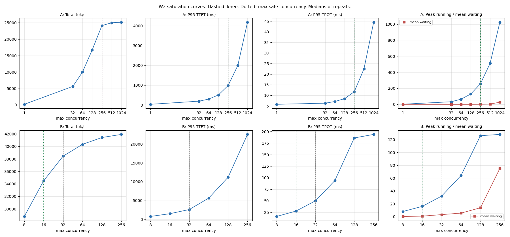
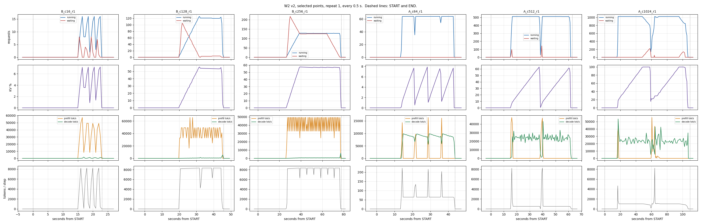

# W2 v2 Saturation Record

The tables and charts below are generated by `lab_report.py w2` from the benchmark
JSONs, counter snapshots, the monitor's `watch.csv` and the runner's `events.tsv` in
`w2/` (and `lever/w2/`). Nothing in them is typed by hand. Same pod as W1 v2.
Sections marked **yours** are written after the run.

## Environment

| Field | Value |
|---|---|
| Date | 10 Nov 2026. Sweeps and rate 15:24 to 16:16 UTC; lever 16:41 to 16:47 UTC on a rebuilt container |
| vLLM | 0.29.0 |
| Image tag used | `v0.29.0` |
| GPU | H100 SXM 80GB. nvidia-smi: "NVIDIA H100 80GB HBM3", 81,559 MiB |
| Driver | 595.91.07, CUDA 13.2 |
| Region | Not recorded (same gap as W1) |
| GPU rate paid | $3.99/hr, On-Demand, Secure |
| Model | Qwen/Qwen2.5-7B-Instruct |
| max-model-len | 8192 |
| gpu-memory-utilization | 0.85 |
| Client | `vllm bench serve`, random dataset, `/v1/completions`, `--random-range-ratio 0 --ignore-eos --temperature 0`, unique `--seed` per run |
| GPU minutes used | W2: about 92 min (15:20 to about 16:52), including about 20 min for the block 6 restart. Whole pod with W1: 14:18 to about 16:52, about 154 min, about $10.25. Estimate from timestamps; check the billing page. Sheet estimate for both weeks: $6.50 |

If vLLM is not 0.29.0: say here what that does to comparing against W1.

## Config actually served

Same pod as W1 v2, so the Logs lines are in the W1 v2 record. Paste `bash w2_run.sh preflight` here.

```
==== W2 preflight ====
served model OK: Qwen/Qwen2.5-7B-Instruct
vllm 0.29.0   gpu NVIDIA H100 80GB HBM3
WARNING: GPU is not an SXM part. Record it; it changes comparability.
KV capacity: 921504 tokens (57594 blocks of 16)

Predictions to test (H100 SXM 80GB, vLLM 0.29.0 defaults; derivations in the run sheet):
  token budget 8,192 per step, sequence cap 1,024, KV capacity ~880,000-940,000 tokens
  B: running plateaus near 126 from c=128 up; req/s flat past it (~8-11, estimate);
     tok/step near 8,192 when saturated; P95 TPOT rises to ~200 ms+ (estimate); KV ~58%
  A: c=1 below the ~220 tok/s paper ceiling; running = c up to 512; KV ~32% at 256, ~65% at 512;
     at 1024 KV pins near 100% and preemptions start; throughput no higher than at 512
  preemptions: zero on B and on A up to 512; above zero at A c=1024, on default config
[15:24:19.260] MARK   preflight  done
```

The SXM warning is false: the pod copy of `lab_lib.sh` still had the W1 bug (fixed in `kit/`).

Block 6 server, from the Logs tab after Edit Pod:

```
non-default args: {..., 'max_model_len': 8192, 'gpu_memory_utilization': 0.85, 'max_num_batched_tokens': 2048, 'max_num_seqs': 256}
GPU KV cache size: 934,880 tokens, Maximum concurrency for 8,192 tokens per request: 114.12x
```

## Predictions, written before the run

| Quantity | Predicted | Basis | Measured (**yours**) |
|---|---|---|---|
| KV capacity | ~880,000 to 940,000 tokens | 79.6 GiB × 0.85 − 14 GiB weights − 3 to 5 GiB overhead, ÷ 56 KiB | 921,504 tokens (57,594 blocks). Inside the range. Block 6 config: 934,880 (+1.5%) |
| Token budget | 8,192 per step | vLLM 0.29.0 default for ≥ 70 GiB, not "a100", OpenAI server | 8,192. Plateau steps read 8,312 to 8,318 because a prompt's tokens are booked in the step where its prefill completes |
| Sequence cap | 1,024 | same | 1,024. A at c = 1,024 ran 1,024 at once |
| Sweep prefix hits | ~0 | unique seed per run | ~0 (112 to 8,160 background tokens per run), except the A c = 1,024 r1 re-run: 89,824 (34%), because it reused the failed run's seed |
| B, peak running at c ≥ 128 | ~126 | *R* = 64 × (8,192 − *R*) ÷ 4,096 | 126 at c = 128, 128 at c = 256 (plateau 127 with 125 waiting). Confirmed |
| B, req/s past the knee | ~8 to 11, flat (estimate) | A100's ~3.3 × compute ratio 3.2, less overhead | 9.96 at c = 128, 10.08 at c = 256. Confirmed. But the curve was already flat from c = 32 (9.24): see finding 1 |
| B, P95 TPOT at c ≥ 128 | ~200 ms or more (estimate) | each step carries up to 8,192 tokens | 186 ms at c = 128, 194 ms at c = 256. Close, slightly below |
| B, peak KV | ~58% | 126 × 4,160 ÷ ~910,000 | 56.1% at c = 128, 57.4% at c = 256. Confirmed |
| B, median tokens per step at c ≥ 128 | near 8,192 | budget binds | Plateau 8,312 to 8,318. The report's per-run figure (5,379 and 6,068) includes ramp and drain. Confirmed for the plateau |
| A, output tok/s at c = 1 | below ~220 | 15.2 GB weights read per token at 3.35 TB/s | 172 tok/s, identical in all three repeats: 78% of the paper ceiling. TPOT 5.77 ms against 4.5 ms on paper. Confirmed |
| A, peak running | c, up to ~790 | KV binds before the 1,024 cap | 1,024 at c = 1,024. **Broken.** All 1,024 were admitted; the cache filled later, about 900 tokens into each request, and preemption then pulled running down to about 800. See finding 3 |
| A, peak KV at c = 256 / 512 | ~32% / ~65% | c × 1,152 ÷ ~910,000 | 31.6% / 63.0%. Confirmed |
| A, throughput 512 → 1,024 | flat or lower | preemption recomputes evicted work | 21.69 → 21.82 req/s (+0.6%), P95 TPOT 22.5 → 44.5 ms. Confirmed: flat, at twice the latency |
| Preemptions, default config | 0 on B and on A up to 512; above 0 at A c = 1,024 | KV fills near 790 requests | 0 on all B runs and on A up to 512. A c = 1,024: 388, 397, 401 per run. Confirmed |
| Lever: B c = 128 at budget 2,048 | running ~32, waiting ~96, TPOT down, throughput ± unknown | the A100 default; PR #17885 | Running 33, about 96 waiting at the plateau, P95 TPOT 186 → 51 ms, req/s 9.96 → 9.48 (−5%), mean TTFT 3.6 → 8.4 s. Confirmed; the open item resolves as a 5% loss |
| Lever: A c = 1,024 at seq cap 256 | running 256, waiting ~768, preemptions 0, KV ~32% | the cap queues instead of evicting | Running 256, waiting 768, preemptions 0, peak KV 31.4%, req/s 20.91 (default c = 256: 20.94), P95 TTFT 37.7 s. Confirmed |

Where a measurement disagrees, do not edit the prediction. Write what you saw.

## Curves

![[w2_report.md]]

Outside Obsidian: [w2_report.md](w2_report.md).





## Max safe concurrency (**yours**)

One sentence per shape: the number, which limit set it, and the metric that shows it.

- **A, decode-heavy: 256.** Set by the GPU's decode capacity at large batches, not by KV memory (32% used) or the sequence cap (1,024). From 256 to 512, throughput rises 3.6% while P95 TPOT doubles (11.7 → 22.5 ms); at 256, mean waiting 0.7 and zero preemptions. The script agrees.
- **B, prefill-heavy: 32.** Set by prefill compute. Total throughput 38,440 tok/s at c = 32, only 9% more at c = 256. The script says 16 because B at c = 32 averaged 3.2 waiting, but that queue comes from the lockstep waves of fixed-length synthetic requests: all 32 finish and refill together. With random arrivals at 7.06 req/s, B peaked at 32 running with 0 waiting and a 230 ms median TTFT. Real traffic is burstier than random arrivals, so cap near 32 and alert on waiting above 0.

## Hypothesis verdicts (**yours**)

1. **B queues on the token budget, not memory** (W1 finding 3). **Confirmed.** At c = 256: 127 running, 125 waiting, KV 57%, steps at 8,318 tokens, zero preemptions. Block 6 moves the plateau with the budget, not with memory: at 2,048 running drops to 33 at KV 14.5%. Refinement: the budget sets *how many run*; throughput was capped earlier, by prefill compute (finding 1).
2. **No preemptions at default config.** **Holds on B and on A up to 512; fails at A c = 1,024**, as the sheet predicted for the H100: 1,186 preemptions over three runs. Block 6: a sequence cap of 256 brings the same load to zero preemptions, by queueing.

## Cost view, lab only

Cost per 1M output tokens at A's max safe concurrency against A at c = 32, from the
table. The difference is the price of running a GPU below its knee. USD at $3.99/hr, lab prices.

| | A at c = 32 | A at max safe | Change |
|---|---|---|---|
| $ per 1M output tokens | $0.2215 | $0.0517 (c = 256) | −77% (4.3× cheaper) |
| P95 TPOT ms | 6.29 | 11.68 | +86% |

Running A at c = 32 leaves 77% of the GPU's paid output unused. Past the knee there is nothing left to buy: c = 1,024 costs $0.0496, 4% less than c = 256, for 3.8× the P95 TPOT and about 400 preemptions a run.

## Findings and open questions (**yours**)

1. **B's knee is c = 32, four times below where the budget caps running.** Throughput: 9.24 req/s at c = 32, 9.70 at 64, 10.08 at 256 (+9% in total). Over the same range P95 TTFT goes 2.6 s → 22.5 s and P95 TPOT 50 → 194 ms. Past c = 32, more concurrency buys queue, not output. Why, in my words: B is almost all prefill, and prefill is limited by compute. At c = 32 the GPU's compute was already almost fully used, so extra requests only wait. The numbers: 10 req/s × 4,096 prompt tokens is about 41,000 prompt tok/s; full prefill steps ran near 49,000 tok/s on the monitor, and the average sits lower because some steps carry decode and the run ramps up and drains. The token budget (8,192) decides how many requests run at once (126); it does not decide how fast. Compute caps the speed well before the budget caps the count.
2. **A flattens at c = 256 with the cache only 32% full.** Neither memory nor a scheduler limit binds. Step time grows with the batch: TPOT 6.3 ms at c = 32, 11.4 ms at 256, 21.9 ms at 512. From 256 to 512, doubling the batch doubles step time, so output per second stays flat. Working explanation, not verified: past about 256 tokens per step, decode stops being bound by reading the weights once per step and becomes bound by compute plus the attention reads of every request's KV. Rough check at c = 512 (estimates): about 8 ms of matrix maths, 5.5 ms of KV reads, 4.5 ms of weight reads, about 18 ms against 21.9 ms measured.
3. **vLLM admits on today's KV, not on the KV a request will need.** At A c = 1,024 all 1,024 requests were admitted: 128 prompt tokens each fit easily. Each then grew one token per step until the cache filled at about 900 tokens per request (921,504 ÷ 1,024), short of the 1,152 each needs. vLLM then evicted requests (388 to 401 per run), discarding their KV and recomputing it later. Running fell to about 800. The prediction of a cap near 790 assumed admission reserved room for the output. It does not. In production: short prompts with long outputs and no concurrency cap is the pattern that preempts, and low KV at admission does not mean safe.
4. **Preemption is nearly free in throughput and expensive in latency.** A c = 1,024 ran 21.82 req/s against 21.69 at c = 512, despite about 400 evictions a run, because recomputing a 900-token prefix is cheap next to decoding it. The cost lands on users: P95 TPOT 44.5 ms against 22.5 ms. The only place it shows on the server is `vllm:num_preemptions_total`.
5. **Sweep TTFT is queueing, not serving speed.** A at c = 256: P95 TTFT 981 ms. A at a fixed 15.2 req/s with Poisson arrivals, a similar 145 running: median 43 ms, P95 58 ms. B: 2.6 s P95 at c = 32 against 230 ms median and 549 ms P95 at 7.06 req/s (W1: 195 ms median at 6.4 req/s). Quote TTFT at a stated arrival rate, never from a burst.
6. **The two scheduler flags trade who waits; neither adds capacity.**
   - Token budget 8,192 → 2,048, B at c = 128: P95 TPOT 186 → 51 ms, mean TTFT 3.6 → 8.4 s, req/s −5%. P95 TTFT barely moved (11.2 → 12.0 s) while the mean more than doubled: the large budget lets most requests in quickly and leaves a tail waiting; the small budget makes everyone wait.
   - Sequence cap 1,024 → 256, A at c = 1,024: preemptions about 400 → 0, P95 TPOT 44.5 → 11.8 ms, P95 TTFT 4.2 → 37.7 s, req/s 20.91, the same as default c = 256 (20.94). A cap of 256 is A's max safe concurrency enforced by the server: excess load queues where it is visible and costs no recompute.
   - Which to choose depends on the product: chat users feel TTFT, streaming readers feel TPOT, batch jobs feel throughput.
7. **A smaller step budget leaves more room for KV.** 934,880 tokens at 2,048 against 921,504 at 8,192 (+1.5%, about 0.7 GiB). vLLM profiles one full-budget step and reserves its activation memory before sizing the cache. Small on a 7B model; not worth tuning for.
8. **The load generator can be the bottleneck.** The first A c = 1,024 run completed 996 of 2,048: `Errno 24 Too many open files` at the shell's 1,024 limit (1,024 minus about 28 files Python already holds). The server saw only 996 running and reported nothing wrong. Check client-side errors and limits before reading a server failure.
9. **About 14 minutes of the GPU sat idle before load.** From START to the first running request: mean 16.6 s over 46 W2 runs (13.8 s on A c = 64, 26.5 s on B c = 256; it grows with the prompt count), plus 19.4 s on the lever runs. About 14 min, about $0.93. The client builds random prompts after START. W1 open item, now measured.

Open after W2:

- Finding 2's explanation is an estimate. A profile of one decode step at c = 256 and 512 would settle it.
- Whether a pod volume survives Edit Pod (block 6 lost the container, the model cache and sshd).
- The A c = 1,024 r1 prefix hits come from the reused seed: hypothesis, not checked in the cache.

## Deviations from the run sheet

Anything run differently from the sheet: skipped points, a changed ladder, a failed
run, the image tag, block 6 skipped, a different pod from W1 v2.

1. **Block 1a skipped** while the pod billed. Still to do on paper; its answers are in the sheet.
2. **A_c1024_r1 failed on the first attempt**: 996 of 2,048, client `Errno 24` with `ulimit -n 1024`. Re-run after `ulimit -n 65536`. `A_c1024_r1.failed.json` kept.
3. **The re-run reused the failed run's seed**: 89,824 prefix hits (34%), lower TTFT (2.24 s against 3.00 s on r2). It is not the median for req/s (r3 is, at 21.82); it lifts the report's prefix-hit figure for that point to 12%. Read r2 and r3 as the clean numbers.
4. **`rate` read `A_c1024_r1.failed.json` into c = 1,024's median.** Its file pattern matched the kept failure, so c = 1,024's median was 21.54 over four files, below c = 512's 21.69, and A's rate came from c = 512 (0.7 × 21.69 = 15.18 req/s). The right answer by luck: c = 1,024 preempts and should never be the target. Fixed in `w2_run.sh` after the run: failed files are skipped and points with preemptions excluded. Re-checked against this data: A 21.69 (c = 1,024 excluded), B 10.08, the same rates. A's achieved 12.81 req/s against the 15.18 target is the drain tail counted in the run's duration, not a shortfall in arrivals.
5. **Block 6 ran on a rebuilt container.** Edit Pod removed and recreated the container: sshd gone, `/workspace` empty, the model downloaded again. About 20 min from save to ready (16:21 to 16:41). sshd restarted through the web terminal, kit copied again, `ulimit -n 65536` set. No `preflight`, so `lever/w2/` has no `env.txt` or start snapshot; `env-final.txt` holds the config.
6. **False "not an SXM part" warning** in preflight from the pod copy of `lab_lib.sh`.
7. `w2/events.tsv` also holds W1's events (same pod, same runner log). The report reads only W2 tags.

## Raw data

`w2/json/` one benchmark JSON per run. `w2/metrics/` counters before and after each
run. `w2/watch.csv` the monitor every 0.5 s. `w2/events.tsv` every runner step with its
timestamp. `w2/logs/` client output, key redacted. `w2/env.txt` version, GPU, cache
config. Tags: `<shape>_c<concurrency>_r<repeat>`, `<shape>_rate_r<repeat>`, `L_` for
block 6 in `lever/w2/`.
